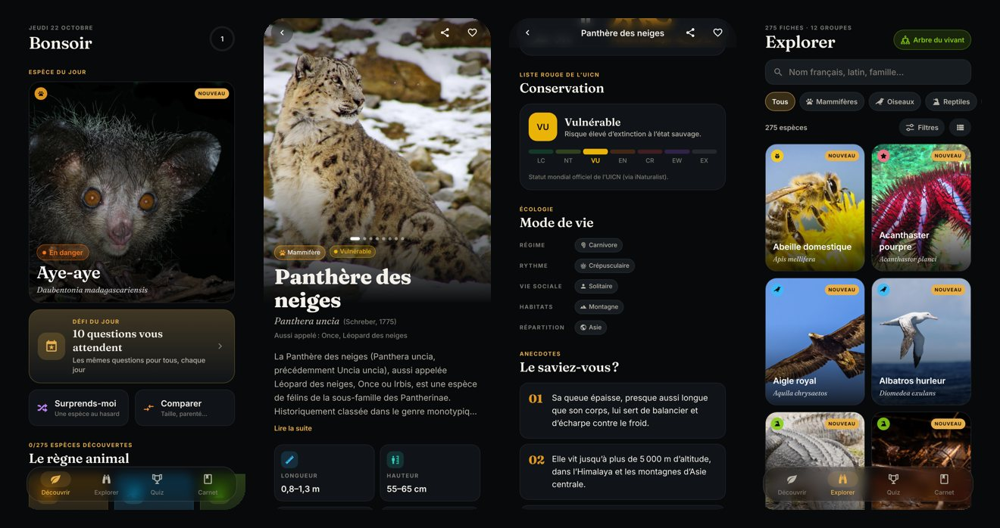
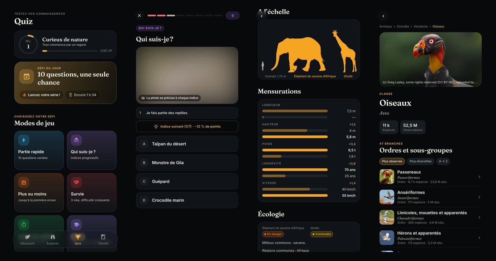

# 🦉 Faunapedia

**L’encyclopédie zoologique de poche pour les passionnés.** Une application mobile (iOS & Android) moderne, pensée pour les smartphones haut de gamme : des fiches riches et rigoureuses, l’arbre du vivant complet consultable en direct, et des quiz qui donnent envie d’y revenir chaque jour.

> Projet passion, sans publicité, sans compte ni collecte de données.




---

## Ce que contient l’application

### 📚 Une encyclopédie exigeante
- **275 fiches rédigées avec soin** couvrant tout le règne animal : mammifères, oiseaux, reptiles, amphibiens, poissons, insectes, arachnides, crustacés, mollusques, cnidaires, échinodermes et autres invertébrés (tardigrade, limule, ver tubicole géant…).
- Pour chaque espèce : mensurations (longueur, hauteur, envergure, poids, longévité, vitesse), régime, rythme d’activité, vie sociale, habitats, répartition, **records**, **anecdotes « Le saviez-vous ? »** et étymologie.
- **Données ouvertes enrichies** : photos sous licence Creative Commons (auteurs crédités), classification complète du règne à l’espèce, **statut mondial UICN officiel**, résumé et article Wikipédia, silhouettes PhyloPic.
- **Comparaison d’échelle** : l’animal dessiné à côté d’un humain, d’une carte bancaire ou d’une pièce de 1 € selon sa taille.
- **Carte de répartition mondiale** (GBIF) limitée aux observations de terrain, pour ne pas confondre aire naturelle et zoos ou musées.
- **Écouter** : enregistrements sonores de terrain (chants, cris, coassements) issus d’iNaturalist.
- **Espèces apparentées** calculées à partir de la classification.

### 🌳 L’arbre du vivant, en entier
- Navigation **en direct** dans plus d’un million d’espèces animales (iNaturalist), de l’embranchement à l’espèce, avec fil d’Ariane, nombre d’espèces et d’observations, résumé Wikipédia.
- Toute espèce, même absente des fiches rédigées, dispose d’une **fiche dynamique** : galerie, statut, carte, sons, article.
- **Recherche mondiale** depuis l’explorateur.

### 🎯 Des quiz qui donnent envie
| Mode | Principe |
|---|---|
| **Défi du jour** | 10 questions identiques pour tous, chaque jour, avec série de jours consécutifs 🔥 |
| **Partie rapide** | 10 questions variées ; difficulté et thème au choix |
| **Qui suis-je ?** | Indices progressifs et photo floue qui se précise ; moins d’indices = plus de points |
| **Plus ou moins** | Duels (plus lourd, plus rapide, plus long, vit plus longtemps) jusqu’à la première erreur |
| **Survie** | 3 vies, difficulté croissante |
| **Contre-la-montre** | 60 secondes, chaque erreur coûte 3 s |
| **Expert** | Noms latins, ordres, familles, statuts UICN, avec des leurres très proches |
| **Silhouettes** | Reconnaître un animal à sa seule ombre |
| **Chants & cris** | Enregistrements réels de terrain |
| **Révision** | Les espèces ratées reviennent à intervalles croissants (répétition espacée) |
| **Me tester** | 5 questions sur la fiche que vous venez de lire |

Plus de quinze types de questions (identification par photo, photo à retrouver, silhouette, nom scientifique, classification, statut UICN, records, anecdotes, géographie, régime, vrai/faux…), un score qui récompense **rapidité, difficulté et séries**, des explications après chaque réponse et un lien direct vers la fiche.

### 🏅 Une vraie progression
- **Niveaux et rangs** inspirés des grands naturalistes : de « Curieux de nature » à « Héritier de Linné ».
- **Une quarantaine de badges**, dont un par spécialité (Ornithologue, Herpétologue, Batrachologue, Malacologue, Carcinologue…), des séries quotidiennes et quelques badges secrets.
- **Carnet de terrain** : progression par groupe, favoris, dernières découvertes, statistiques.

### 🧭 Et aussi
- **Comparateur** : parenté (dernier ancêtre commun), échelle commune, mensurations face à face.
- **Autour de moi** : les espèces réellement observées près de vous… ou en voyage virtuel (Camargue, Serengeti, Galápagos, Bornéo…).
- **16 collections thématiques** : records, abysses, faune de France (outre-mer compris), venimeux et vénéneux, camouflage, fossiles vivants, migrateurs, espèces disparues…
- **Surprends-moi** : secouez le téléphone pour découvrir une espèce au hasard.
- Thème sombre (pensé pour les écrans OLED) et clair, retours haptiques, onglets natifs **Liquid Glass** sur iOS 26.

---

## Essayer sur votre téléphone

Prérequis : [Node.js](https://nodejs.org) 20 ou plus, et l’application **Expo Go** sur votre téléphone ([iOS](https://apps.apple.com/app/expo-go/id982107779) · [Android](https://play.google.com/store/apps/details?id=host.exp.exponent)).

```bash
git clone https://github.com/Aesmyrel/Faunapedia.git
cd Faunapedia
npm install
npx expo start
```

Scannez le QR code affiché (appareil photo sur iPhone, Expo Go sur Android) : l’application s’ouvre aussitôt.

Pour installer une vraie application autonome (APK Android ou build iOS interne) sans passer par un store, utilisez EAS :

```bash
npx eas-cli@latest build --profile preview --platform android
```

## Développement

```bash
npm run typecheck   # vérification TypeScript
npm run lint        # ESLint (règles React Compiler incluses)
npm test            # tests unitaires (moteur de quiz, recherche, progression…)
npm run data:build  # ré-enrichit les fiches depuis les API ouvertes
npx expo start --web  # aperçu dans le navigateur
```

### Architecture

```
src/
├── app/                 Écrans (Expo Router, routage par fichiers)
│   ├── (tabs)/          Découvrir · Explorer · Quiz · Carnet
│   ├── species/[id]     Fiche espèce
│   ├── taxon/[id]       Arbre du vivant (en direct)
│   ├── quiz/[mode]      Session de jeu
│   └── …                groupe, collection, comparateur, autour de moi, badges, à propos
├── components/          Interface réutilisable (ui, species, quiz, home, taxon…)
├── data/
│   ├── curated/         Fiches rédigées à la main (une par groupe)
│   ├── generated/       Données enrichies par le script (photos, taxonomie, UICN…)
│   ├── reference.ts     Groupes, statuts UICN, habitats, collections…
│   └── types.ts         Modèle de données
├── lib/                 Logique pure et testée : quiz, recherche, progression, API, formats
├── hooks/               Thème, haptique, chargement réseau, secousse
└── store/               État persistant (Zustand + AsyncStorage)
scripts/
├── build-data.mts       Enrichissement : iNaturalist, Wikipédia, GBIF, PhyloPic
└── make-icons.py        Génération de l’icône et de ses déclinaisons
```

- **Stack** : Expo SDK 58, React Native 0.88, React 19 + React Compiler, Expo Router, Reanimated 4, expo-image, expo-audio, react-native-svg, Zustand.
- **Hors ligne** : les fiches rédigées et leurs données enrichies sont embarquées ; les photos sont mises en cache après le premier affichage. L’arbre du vivant, les cartes, les sons et les articles nécessitent une connexion.
- **Contenu en français** avec typographie soignée (espaces fines insécables, guillemets) et accords grammaticaux gérés dans les questions générées.

### Ajouter une espèce

1. Ajoutez une entrée dans le fichier du groupe concerné, dans `src/data/curated/` (nom scientifique exact, mensurations, anecdotes…).
2. Lancez `npm run data:build <id-de-l-espece>` pour récupérer photos, classification, statut UICN, résumé et silhouette.
3. Vérifiez la fiche dans l’application, puis lancez `npm test`.

## Sources et licences

| Source | Usage | Licence |
|---|---|---|
| [iNaturalist](https://www.inaturalist.org) | Classification, photos, statuts UICN, sons, observations | Licences Creative Commons, auteurs crédités sur chaque fiche |
| [Wikipédia](https://fr.wikipedia.org) | Résumés et articles | CC BY-SA 4.0 |
| [GBIF](https://www.gbif.org) | Cartes de répartition | Données ouvertes, citations par jeu de données |
| [PhyloPic](https://www.phylopic.org) | Silhouettes | Licences indiquées sur chaque fiche |
| [Liste rouge de l’UICN](https://www.iucnredlist.org) | Statuts de conservation | Via iNaturalist |
| Material Design Icons, Font Awesome | Icônes | Apache 2.0 / SIL OFL |
| Fraunces, Inter | Typographies | SIL Open Font License |

Les mensurations et anecdotes sont des ordres de grandeur pour des adultes à l’état sauvage et varient selon les sources. Une erreur ? Les corrections sont les bienvenues.
